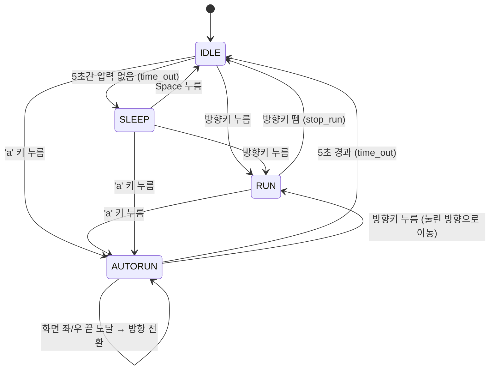

# DRILL13 개발 문서 — 자동 무적 런(AutoRun) 상태 추가

## 1. 개요

소년(Boy)에 **AutoRun(자동 무적 런)** 상태를 추가한다.
IDLE 상태에서 `a` 키를 누르면 키 조작 없이도 소년이 좌우로 계속 이동한다.

현재 상태: `IDLE`, `RUN`, `SLEEP` (`boy.py`, `transitions`의 `GraphMachine` 사용)
추가 상태: `AUTORUN`

## 2. 요구사항

| # | 요구사항 |
|---|----------|
| R1 | IDLE, RUN, SLEEP 어느 상태에서든 `a` 키를 누르면 AutoRun 상태가 된다. |
| R2 | AutoRun 중에는 키 조작 없이 계속 좌우로 이동한다. |
| R3 | AutoRun 중에는 일반 RUN보다 **속도가 빠르고**, **크기가 확대**된다. |
| R4 | 화면 좌/우측 끝에 닿으면 **자동으로 방향이 전환**된다. |
| R5 | AutoRun 진입 후 **5초 이상** 경과하면 IDLE로 돌아간다. |
| R6 | AutoRun 중 **방향키**가 눌리면 AutoRun이 취소되고, 눌린 방향으로 움직이는 RUN 상태로 전환된다. |
| R7 | **반드시 `AutoRun` 상태 클래스를 추가**하여 구현한다. |
| R8 | **반드시 상태 다이어그램을 함께 작성**한다. |
| R9 | 개발 중간에 **최소 10회 정도의 적절한 커밋**을 한다. (5장 참고) |

## 3. 상태 다이어그램



> `a` 키는 IDLE / RUN / SLEEP 모든 상태에서 AutoRun으로 진입할 수 있다.
> `state_diagram.py`(GraphMachine)로 생성한 PNG도 함께 갱신해 저장소에 포함한다.

### AutoRun 상태 동작 요약

| 항목 | 값 |
|------|----|
| 진입 (enter) | 진입 시각 기록, 방향은 현재 `face_dir` 유지 |
| 이동 속도 | `AUTORUN_SPEED` (예: 15, 일반 `RUN_SPEED`=5보다 빠름) |
| 크기 | 100×100 → 약 200×200 (`AUTORUN_SCALE = 2`) |
| 경계 처리 | `x <= 0` 또는 `x >= 800` 이면 `face_dir *= -1` |
| 종료 조건 | 5초 경과 → IDLE / 방향키 입력 → RUN |
| 퇴장 (exit) | 필요 시 상태 값 정리 |

## 4. 설계

### 4.1 AutoRun 상태 클래스 (필수)

기존 `Boy` 클래스에 상태 클래스 `AutoRun`을 추가한다.
각 상태는 동일한 인터페이스(`enter`, `exit`, `do`, `draw`)를 가진다.

```python
AUTORUN_TIME  = 5.0
AUTORUN_SPEED = 15
AUTORUN_SCALE = 2

class AutoRun:
    def __init__(self, boy):
        self.boy = boy
        self.start_time = 0.0

    def enter(self):            # 진입: 시작 시각 기록
        self.start_time = get_time()

    def exit(self):             # 퇴장 정리
        pass

    def do(self):               # 프레임 갱신, 이동, 끝에서 방향 전환
        ...

    def is_timeout(self):       # 5초 경과 여부
        return get_time() - self.start_time >= AUTORUN_TIME

    def draw(self):             # 확대된 크기로 그리기
        ...
```

### 4.2 Boy 수정 사항

- `states`에 `'AUTORUN'` 추가
- 전이 추가
  - `a_down`: `['IDLE', 'RUN', 'SLEEP'] → AUTORUN`
  - `autorun_timeout`: `AUTORUN → IDLE` (`after='reset_idle_timer'`)
  - `start_run`의 출발 상태에 `'AUTORUN'` 추가 (방향키로 취소)
- `handle_event`
  - `SDLK_a` KEYDOWN + 현재 IDLE/RUN/SLEEP → `a_down()` (SLEEP의 조기 `return` 이전에 처리)
  - AUTORUN 중 방향키 KEYDOWN → `face_dir` 갱신 후 `start_run()`
- `update` / `draw`에서 AUTORUN 상태는 `AutoRun` 객체에 위임

## 5. 커밋 계획 (필수: 최소 10회 내외)

개발 **중간중간** 의미 단위로 커밋한다. 한 번에 몰아서 커밋하지 않는다.

1. `docs: AutoRun 개발 문서(DEVELOPMENT.md) 추가`
2. `docs: 상태 다이어그램(mermaid) 추가`
3. `feat: AutoRun 상태 클래스 뼈대 추가`
4. `feat: Boy states/transition에 AUTORUN 등록`
5. `feat: IDLE/RUN/SLEEP에서 'a' 키로 AutoRun 진입`
6. `feat: AutoRun 좌우 자동 이동 및 속도 증가`
7. `feat: AutoRun 화면 끝 자동 방향 전환`
8. `feat: AutoRun 크기 확대 그리기`
9. `feat: AutoRun 5초 경과 시 IDLE 복귀`
10. `feat: AutoRun 중 방향키 입력 시 RUN으로 전환`
11. `docs: state_diagram.py로 상태 다이어그램 이미지 갱신`
12. `test/chore: 동작 확인 및 정리`

## 6. 검증 체크리스트

- [ ] IDLE, RUN, SLEEP 각각에서 `a` → AutoRun으로 전환되어 키 조작 없이 계속 이동한다.
- [ ] AutoRun 중 일반 RUN보다 빠르고 크게 그려진다.
- [ ] 좌/우 화면 끝에서 방향이 자동 전환된다.
- [ ] 약 5초 후 IDLE로 돌아간다.
- [ ] AutoRun 중 ←/→ 입력 시 해당 방향 RUN으로 전환된다.
- [ ] `AutoRun` 클래스가 존재한다.
- [ ] 상태 다이어그램이 문서/이미지로 포함되어 있다.
- [ ] 커밋이 개발 중간에 10회 이상 나뉘어 있다 (`git log --oneline`로 확인).
